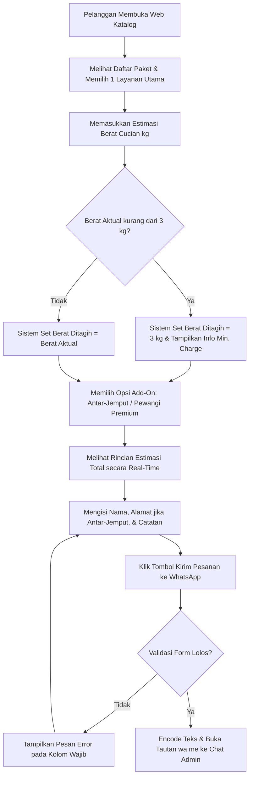

# Product Requirements Document — LaundryCalc & Catalog

**Document Version:** 1.0  
**Application Version:** MVP (v0.1)  
**Status:** Draft  
**Last Updated:** 18 November 2026  

---

## 1. Document Information

| Attribute | Details |
| :--- | :--- |
| **Product Name** | LaundryCalc (Katalog & Kalkulator Estimasi Laundry) |
| **Product Type** | Mobile-First Responsive Web Application (Tanpa Login / Akun) |
| **Primary Platform** | Modern Mobile Browser (Chrome, Safari) & Desktop |
| **Target MVP Version** | v0.1 (Katalog layanan, kalkulator otomatis dengan aturan *minimum charge*, dan generator template WhatsApp) |
| **PRD Status** | Draft (Menggunakan struktur standar & aturan yang direkomendasikan) |

---

## 2. Problem Background

* **Core Problem:** Calon pelanggan sering ragu atau menunda pemesanan karena belum mengetahui perkiraan total biaya cucian (termasuk ketentuan berat minimum dan biaya layanan tambahan). Di sisi operasional, admin toko laundry tersita waktunya untuk membalas pertanyaan harga berulang di WhatsApp dan merapikan format pesanan yang tidak standar.
* **Affected Persona:** Calon pelanggan laundry (rumah tangga, mahasiswa, pekerja) dan Admin Operasional Toko Laundry.
* **Current Manual Workarounds:** Pelanggan mengirim pesan WhatsApp menanyakan daftar harga per kg, menghitung estimasi secara manual, lalu mengetik detail pesanan tanpa format baku.
* **Consequences of Inaction:** Waktu respons admin lambat, calon pelanggan berpindah ke kompetitor karena kurangnya transparansi biaya di awal, serta berisiko terjadi selisih paham saat berat cucian di bawah batas minimum (3 kg).

---

## 3. Product Goals & Success Indicators

| Goal ID | Objective | Success Indicator | Target | Measurement Method |
| :--- | :--- | :--- | :--- | :--- |
| **GL-01** | Mengurangi beban chat tanya-jawab tarif dasar | Penurunan pesan masuk kategori *price inquiry* dasar | Turun $\ge 40\%$ dalam 1 bulan | Audit log chat masuk WhatsApp admin mingguan |
| **GL-02** | Mempercepat konversi pesanan masuk | Proporsi lead pesanan yang masuk menggunakan format template web | $\ge 75\%$ dari total pesanan via WA | Rekap format pesan masuk WhatsApp |
| **GL-03** | Meningkatkan transparansi aturan *minimum charge* | Penurunan keluhan atau pembatalan akibat penyesuaian batas berat minimum | Komplain tarif $< 2\%$ dari total transaksi | Log keluhan operasional kasir/kurir |

---

## 4. Target Users & Roles

* **Pelanggan (Customer):**
  * **Tujuan:** Melihat daftar paket layanan beserta estimasi durasi pengerjaan, menghitung total perkiraan biaya cucian berdasarkan berat & layanan tambahan, dan mengirimkan rincian pesanan ke WhatsApp toko dalam satu kali klik tanpa perlu registrasi akun.
  * **Friction Points:** Tidak tahu harga pasti sebelum chat, bingung menghitung ketentuan minimum berat, dan malas mengetik format pemesanan dari awal.
* **Admin / Kasir Laundry:**
  * **Tujuan:** Menerima pesan WhatsApp berformat baku yang sudah memuat data pemesan, layanan utama, estimasi berat, berat ditagih, layanan tambahan, dan estimasi total tagihan awal untuk segera dikonfirmasi.
  * **Friction Points:** Harus menanyakan ulang alamat jemput, jenis paket, atau menjelaskan ulang aturan minimum berat secara manual ke setiap pelanggan baru.

---

## 5. Business Logic & Rules

> **Catatan:** Angka tarif paket di bawah ini menggunakan struktur rekomendasi standar yang ditandai sebagai `[Proposed Assumption]` dan dapat disesuaikan melalui konfigurasi data toko sebelum perilisan.

### BL-01: Perhitungan Berat Ditagih (*Minimum Charge Rule*)
* **Trigger:** Pengguna memasukkan estimasi berat cucian ($W_{\text{aktual}}$ dalam satuan kg).
* **Input:** $W_{\text{aktual}}$ (Bilangan desimal $\ge 0,1$ kg).
* **Formula:**
  $$W_{\text{ditagih}} = \max(3.0, W_{\text{aktual}})$$
* **Expected Output:** Nilai berat tertagih ($W_{\text{ditagih}}$) yang menjadi pengali untuk biaya layanan utama dan *add-on* berbasis berat.
* **Constraints & Exceptions:**
  * Nilai input berat tidak boleh $\le 0$ atau kosong.
  * Jika $W_{\text{aktual}} < 3,0\text{ kg}$, sistem wajib menampilkan indikator informasi bahwa ketentuan *minimum charge* 3 kg diterapkan.

### BL-02: Kalkulasi Layanan Utama & Layanan Tambahan (*Add-On*)
* **Trigger:** Pengguna memilih 1 paket layanan utama dan mengaktifkan/menonaktifkan opsi layanan tambahan.
* **Daftar Tarif Referensi `[Proposed Assumption]`:**
  * **L01 — Cuci Lipat:** Rp 6.000 / kg (Estimasi selesai: 3 hari)
  * **L02 — Cuci Setrika:** Rp 8.000 / kg (Estimasi selesai: 3 hari)
  * **L03 — Cuci Setrika Ekspres:** Rp 15.000 / kg (Estimasi selesai: 1 hari)
  * **T01 — Antar-Jemput:** Rp 10.000 (Tarif flat per pesanan, radius maks. 5 km)
  * **T02 — Pewangi Premium:** Rp 2.000 / kg (Dikalikan $W_{\text{ditagih}}$)
* **Formula Total Estimasi:**
  $$\text{BiayaUtama} = W_{\text{ditagih}} \times \text{TarifLayanan}$$
  $$\text{BiayaPewangi} = \text{pewangi\_aktif} \ ? \ (W_{\text{ditagih}} \times 2.000) : 0$$
  $$\text{BiayaAntarJemput} = \text{delivery\_aktif} \ ? \ 10.000 : 0$$
  $$\text{TotalEstimasi} = \text{BiayaUtama} + \text{BiayaPewangi} + \text{BiayaAntarJemput}$$
* **Contoh Perhitungan Numerik:**
  * **Contoh 1 (Di bawah minimum charge):** Pelanggan memilih **Cuci Setrika Ekspres** (Rp 15.000/kg), berat aktual **1,8 kg**, dengan **Antar-Jemput** dan **Pewangi Premium**.
    * $W_{\text{ditagih}} = \max(3.0, 1.8) = 3,0\text{ kg}$
    * $\text{BiayaUtama} = 3,0 \times \text{Rp } 15.000 = \text{Rp } 45.000$
    * $\text{BiayaPewangi} = 3,0 \times \text{Rp } 2.000 = \text{Rp } 6.000$
    * $\text{BiayaAntarJemput} = \text{Rp } 10.000$
    * **Total Estimasi:** $\text{Rp } 61.000$
  * **Contoh 2 (Di atas minimum charge):** Pelanggan memilih **Cuci Setrika** (Rp 8.000/kg), berat aktual **4,5 kg**, tanpa *add-on*.
    * $W_{\text{ditagih}} = 4,5\text{ kg}$
    * $\text{BiayaUtama} = 4,5 \times \text{Rp } 8.000 = \text{Rp } 36.000$
    * **Total Estimasi:** $\text{Rp } 36.000$

### BL-03: Validasi Form & Generator Teks Template WhatsApp
* **Trigger:** Pengguna menekan tombol **"Kirim Pesanan ke WhatsApp"**.
* **Validation Rules:**
  1. **Paket Utama:** Harus terpilih tepat 1 layanan utama.
  2. **Estimasi Berat:** Nilai harus $> 0$.
  3. **Nama Pelanggan:** Wajib diisi (minimal 2 karakter non-spasi).
  4. **Alamat Penjemputan:** Wajib diisi apabila opsi *Antar-Jemput* aktif; otomatis terisi `"Antar Sendiri ke Toko"` jika tidak aktif.
* **Processing:** Sistem menyusun string teks pesanan sesuai format standar, melakukan *URL-encoding* (`encodeURIComponent`), lalu mengarahkan browser ke tautan `https://wa.me/<NOMOR_WA_TOKO>?text=<ENCODED_MESSAGE>`.
* **Expected Output:** Aplikasi WhatsApp (mobile atau WhatsApp Web) terbuka langsung ke ruang obrolan toko dengan draf pesan yang siap dikirim.

---

## 6. Feature Requirements

| Feature Code | Feature Name | Requirement Description | Related Business Logic | Priority | Target Version |
| :--- | :--- | :--- | :--- | :--- | :--- |
| **FT-01** | Katalog Paket Layanan | Menampilkan kartu pilihan paket laundry (nama paket, tarif/kg, estimasi durasi pengerjaan, dan deskripsi singkat cakupan layanan). | BL-02 | Must Have | v0.1 |
| **FT-02** | Input Berat & Info *Minimum Charge* | Input angka desimal (step 0,1 kg) atau tombol +/- cepat. Menampilkan banner/badge otomatis saat input $< 3$ kg bahwa berat ditagih dihitung 3 kg. | BL-01 | Must Have | v0.1 |
| **FT-03** | Pilihan *Add-On* Interaktif | Checkbox/toggle untuk memilih layanan tambahan (*Antar-Jemput* dan *Pewangi Premium*) beserta keterangan skema tarifnya. | BL-02 | Must Have | v0.1 |
| **FT-04** | Ringkasan Estimasi *Real-Time* | Panel ringkasan (*sticky bottom bar* di mobile) yang memperbarui rincian biaya utama, biaya tambahan, dan total estimasi secara langsung setiap ada perubahan input. | BL-01, BL-02 | Must Have | v0.1 |
| **FT-05** | Form Data Pemesan | Input **Nama Pelanggan** (wajib), **Alamat Penjemputan** (muncul & wajib jika opsi Antar-Jemput aktif), dan **Catatan Khusus** (opsional, misal: pisah baju luntur). | BL-03 | Must Have | v0.1 |
| **FT-06** | Tombol Kirim ke WhatsApp | Tombol aksi utama yang memvalidasi kelengkapan form dan membuka deep-link WhatsApp dengan pesan terformat otomatis. | BL-03 | Must Have | v0.1 |
| **FT-07** | Informasi Operasional & Disclaimer | Menampilkan jam buka toko, jam layanan jemput, serta catatan bahwa total biaya merupakan estimasi sebelum penimbangan resmi di toko. | - | Should Have | v0.1 |

---

## 7. Main User Flow



### Template Pesan WhatsApp yang Dihasilkan

```text
Halo Admin Laundry, saya ingin memesan layanan dengan rincian berikut:

*Nama:* [Nama Pelanggan]
*Paket Layanan:* [Nama Paket] (Rp [Tarif]/kg)
*Estimasi Berat:* [Berat Aktual] kg (Berat Ditagih: [Berat Ditagih] kg)
*Layanan Tambahan:*
- Antar-Jemput: [Ya (+Rp 10.000) / Tidak]
- Pewangi Premium: [Ya (+Rp BiayaPewangi) / Tidak]

*Alamat Penjemputan:* [Alamat Lengkap / Antar Sendiri ke Toko]
*Catatan Khusus:* [Catatan Khusus / -]

*Estimasi Total Biaya:* *Rp [Total Estimasi]*

_(Catatan: Nominal di atas merupakan estimasi awal. Berat pasti akan ditimbang ulang saat pakaian diterima oleh kurir/kasir toko)._

Mohon konfirmasi jadwal dan ketersediaannya. Terima kasih!
```

---

## 8. Acceptance Criteria

| AC ID | Related Feature | Condition | Expected Behavior | Pass Criteria |
| :--- | :--- | :--- | :--- | :--- |
| **AC-01** | FT-01, FT-04 | Pengguna membuka halaman web dan memilih salah satu paket layanan | Kartu paket terpilih ditandai secara visual dan tarif per kg langsung masuk ke kalkulasi ringkasan. | State aktif terlihat jelas dan subtotal berubah sesuai tarif paket. |
| **AC-02** | FT-02 | Pengguna memasukkan berat `2.0` kg pada paket Cuci Lipat (Rp 6.000/kg) | Sistem menetapkan berat ditagih `3.0` kg, menampilkan pesan info minimum 3 kg, dan menghitung subtotal Rp 18.000. | Label peringatan minimum charge muncul dan nominal subtotal tepat Rp 18.000. |
| **AC-03** | FT-03 | Pengguna memasukkan berat `4.0` kg dan mengaktifkan Pewangi Premium (Rp 2.000/kg) | Sistem menambahkan biaya pewangi sebesar $4 \times \text{Rp } 2.000 = \text{Rp } 8.000$ ke rincian biaya. | Rincian *add-on* menampilkan Rp 8.000 dan total bertambah Rp 8.000. |
| **AC-04** | FT-03, FT-05 | Pengguna mencentang opsi Antar-Jemput (+Rp 10.000) | Kolom input Alamat Penjemputan muncul dan ditandai wajib diisi; total biaya bertambah Rp 10.000. | Kolom alamat tampil aktif dan checkout tertahan jika alamat dikosongkan. |
| **AC-05** | FT-06 | Semua kolom wajib terisi valid dan pengguna menekan tombol kirim ke WhatsApp | Browser memicu navigasi ke `https://wa.me/...` dengan parameter `text` berisi rincian yang identik dengan layar web. | WhatsApp terbuka dengan teks terformat rapi tanpa karakter terpotong. |

---

## 9. Validation Test Scenarios

| Test ID | Related Requirement | Scenario | Test Input | Expected Result | Test Type |
| :--- | :--- | :--- | :--- | :--- | :--- |
| **TC-01** | FT-02, FT-04 | Berat di bawah batas minimum 3 kg tanpa *add-on* | Paket: Cuci Lipat (Rp 6.000), Berat: `1.5` kg, Add-on: Kosong | Berat ditagih = `3.0` kg, Total Estimasi = `Rp 18.000` | Happy Path |
| **TC-02** | FT-02, FT-03, FT-04 | Berat di atas minimum 3 kg dengan seluruh *add-on* | Paket: Cuci Setrika Ekspres (Rp 15.000), Berat: `5.0` kg, Antar-Jemput: Ya, Pewangi: Ya | Biaya Utama: `Rp 75.000`, Add-on: `Rp 20.000`, Total: `Rp 95.000` | Happy Path |
| **TC-03** | FT-02, FT-06 | Input berat bernilai nol atau kosong | Paket: Cuci Setrika, Berat: `0` kg, Nama: `"Rina"` | Tombol submit menampilkan validasi error berat minimal $> 0$ dan tidak membuka WhatsApp | Error |
| **TC-04** | FT-05, FT-06 | Opsi Antar-Jemput aktif tetapi kolom alamat kosong | Antar-Jemput: `true`, Nama: `"Budi"`, Alamat: `""` | Submit diblokir dan muncul pesan error `"Alamat penjemputan wajib diisi"` | Boundary |
| **TC-05** | FT-06 | Input karakter spesial dan simbol pada Catatan Khusus | Catatan: `"Baju putih & batik (jangan dicampur!), telp #2"` | Seluruh teks ter-encode utuh di URL `wa.me` dan terbaca lengkap di chat WhatsApp | Boundary |

---

## 10. Constraints & Out of Scope

### Business Constraints
* Semua harga yang ditampilkan di aplikasi bersifat **estimasi awal**; tagihan final tetap mengacu pada hasil timbangan digital resmi toko saat serah terima pakaian.
* Radius layanan antar-jemput dibatasi maksimal 5 km dari lokasi toko untuk tarif flat `[Proposed Assumption]`.

### Technical & Platform Constraints
* Aplikasi dirancang *mobile-first* agar ringan diakses melalui tautan profil WhatsApp Business, Instagram, atau Google Maps tanpa proses instalasi.
* Bergantung pada ketersediaan aplikasi WhatsApp atau WhatsApp Web pada perangkat pengguna untuk mengeksekusi deep-link `wa.me`.

### Explicit Out of Scope (MVP v0.1)
* **Pembayaran Digital (*Payment Gateway*):** Pembayaran tetap dilakukan secara tunai/transfer/QRIS manual setelah konfirmasi admin di WhatsApp.
* **Pelacakan Status Cucian (*Order Tracking*):** Tidak ada database status pesanan (*dicuci*, *disetrika*, *selesai*) pada versi v0.1.
* **Sistem Akun & Member:** Tidak ada fitur registrasi, login pelanggan, maupun poin loyalitas.
* **Kalkulasi Ongkir Berbasis Peta (Google Maps API):** Ongkos antar-jemput menggunakan tarif flat sederhana, bukan perhitungan jarak per kilometer otomatis.

---

## 11. Data Entities & Storage Requirements

Karena MVP v0.1 berjalan tanpa autentikasi pengguna dan database transaksi backend, seluruh data katalog disimpan dalam file konfigurasi statis (JSON/CMS ringan) agar mudah diperbarui oleh pemilik toko:

1. **StoreConfig (Konfigurasi Toko):**
   * `store_name` (String): Nama toko laundry.
   * `whatsapp_number` (String, format internasional `628...`): Nomor tujuan pesan pesanan.
   * `minimum_charge_kg` (Float, default: `3.0`): Batas berat minimum penagihan.
   * `operational_hours` (String): Informasi jam buka dan jam operasional kurir jemput.
2. **ServicePackage (Paket Layanan Utama):**
   * `id` (String): Kode unik paket (misal: `L01`).
   * `name` (String): Nama layanan (misal: `Cuci Setrika`).
   * `price_per_kg` (Integer): Tarif per kilogram dalam Rupiah.
   * `estimated_days` (Integer): Estimasi lama pengerjaan dalam hari.
   * `description` (String): Penjelasan singkat layanan.
   * `is_active` (Boolean): Status ketersediaan paket.
3. **AddOnService (Layanan Tambahan):**
   * `id` (String): Kode unik add-on (misal: `T01`).
   * `name` (String): Nama layanan tambahan.
   * `pricing_type` (Enum: `flat` | `per_billed_kg`): Metode perhitungan biaya.
   * `price` (Integer): Nominal tarif dalam Rupiah.

---

## 12. Assumptions, Risks & Open Items

* **Assumptions:**
  * `[Proposed Assumption]` Daftar harga paket (Rp 6.000, Rp 8.000, Rp 15.000/kg), batas minimum 3 kg, serta tarif add-on merupakan nilai awal standar yang akan disesuaikan dengan daftar harga riil toko Anda sebelum *go-live*.
  * Calon pelanggan mampu memperkirakan berat cucian secara kasar (misalnya 1 keranjang standar sekitar 3–5 kg).
* **Operational Risks:**
  * **Selisih Berat Aktual vs Estimasi:** Pelanggan menginput 3 kg di web, namun saat ditimbang kurir ternyata 4,5 kg. *Mitigasi:* Menampilkan disclaimer tegas pada layar ringkasan dan di bagian bawah template chat WhatsApp.
* **Open Items (Dapat Dikonfirmasi Sebelum Pengembangan):**
  * Nomor WhatsApp resmi admin toko yang akan menerima pesanan.
  * Penyesuaian akhir daftar harga paket dan radius maksimal antar-jemput toko Anda.

---

## 13. Requirement Traceability Matrix

| Business Logic (BL) | Feature Code (FT) | Acceptance Criteria (AC) | Test Case (TC) |
| :--- | :--- | :--- | :--- |
| **BL-01** (Aturan Minimum Charge 3 kg) | FT-02, FT-04 | AC-02 | TC-01, TC-03 |
| **BL-02** (Kalkulasi Tarif Paket & Add-On) | FT-01, FT-03, FT-04 | AC-01, AC-02, AC-03, AC-04 | TC-01, TC-02 |
| **BL-03** (Validasi Form & Generator WhatsApp) | FT-05, FT-06 | AC-04, AC-05 | TC-03, TC-04, TC-05 |